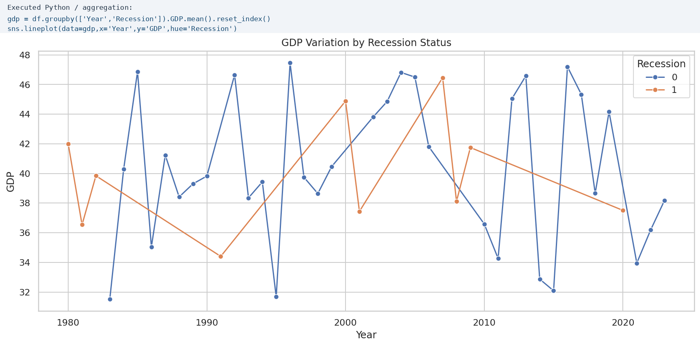

# Automobile Sales During Recession

## Problem / Research Question
How do economic recession periods affect automobile sales, and what patterns can be observed in sales, GDP, unemployment, consumer confidence, vehicle type, price, and advertising expenditure?

## Dataset Source and Usage Permissions
The analysis uses the `automobile-sales.csv` dataset supplied through the CISC7204 / IBM Skills Network course lab. The notebook downloads it from the course-hosted IBM Cloud Object Storage URL.

The dataset is used here for educational coursework and portfolio demonstration. No passwords, API keys, personal data, or restricted/private datasets are included in this repository. If the raw dataset is redistributed, the course/provider terms should be checked first; therefore this repository references the course-hosted source instead of bundling a duplicate data file.

## Methods and Tools Used
- Python
- Jupyter Notebook
- pandas for data manipulation and aggregation
- Matplotlib and Seaborn for visualisation
- requests for downloading the dataset
- Group-by analysis for yearly and recession/non-recession comparisons
- Exploratory analysis of automobile sales, GDP, unemployment, consumer confidence, price, vehicle type, seasonality, and advertising expenditure

## Key Findings
The analysis shows that automobile sales vary substantially across years and tend to weaken during recession periods. Recession-focused comparisons also show that economic conditions such as unemployment and GDP are useful contextual indicators for interpreting changes in vehicle sales. Vehicle type and advertising expenditure provide additional differences in how the market behaves during downturns.


The GDP comparison illustrates how recession and non-recession observations differ over time and provides economic context for the sales trends.



## Limitation
This is an exploratory observational analysis. It identifies associations in the supplied dataset but does not prove that recession status or any single economic variable directly causes changes in automobile sales. The dataset is also a course dataset, so the findings should not automatically be generalized to the entire real-world automobile market.

## How to Run the Analysis
1. Clone this repository.
2. Create and activate a Python virtual environment if desired.
3. Install the required packages:

   ```bash
   pip install -r requirements.txt
   ```

4. Run either the notebook:

   ```bash
   jupyter notebook automobile_sales_analysis.ipynb
   ```

   or the reproducible Python script:

   ```bash
   python analysis.py
   ```

5. The script downloads the course dataset and saves visualizations to the `visualizations/` folder.

## Repository Contents
- `automobile_sales_analysis.ipynb` — completed Jupyter analysis
- `analysis.py` — reproducible script that recreates two portfolio figures
- `requirements.txt` — Python dependencies
- `visualizations/` — portfolio-ready figures

## Project Status
**Completed**
